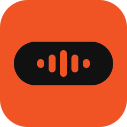
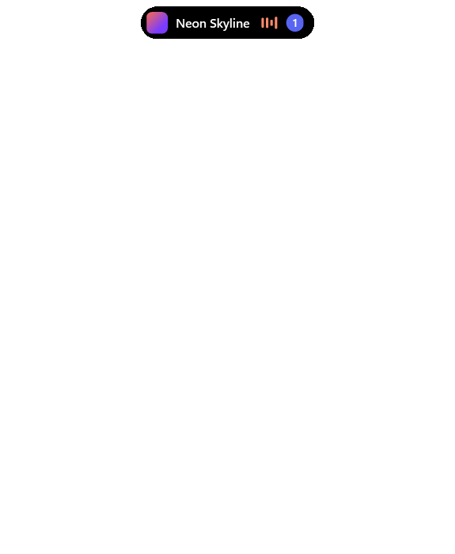

# IslandBar Lite

**English** | [Français](README.md)

A minimal Dynamic Island style bar for Windows 11. It stays invisible until there is something to show, then appears at the top of the screen with your music, your notifications and the apps using your microphone or camera.

**[⬇ Download IslandBar-Lite-Setup.exe](https://github.com/LKDM7/IslandBar-Lite/releases/latest/download/IslandBar-Lite-Setup.exe)**



> Designed and coded with Anthropic's **Claude Opus 5.5**, in Claude Code. Logo drawn with Codex.

## What it does

- **Music:** title, cover art, animated equalizer, play/pause, previous and next track. The progress bar is clickable if the player allows it, and takes the color of the cover art, like the equalizer. On hover, the progress and volume bars preview the value before you click. It follows any player that publishes its media controls to Windows, such as a browser. Clicking the cover art brings the player to the front and, in a browser, selects the tab that is playing.
- **Notifications:** every app by default (Discord, WhatsApp, Teams, mail...). The settings let you remove the ones you don't want. Author, message and image stay on screen for 5 seconds. The number of unread notifications stays visible on the bar. Several messages from the same person fit on one line, for example "Alice (3)".
- **Notifications from your scripts:** `IslandBar.exe --notify "Build finished"` shows your own message. See [Notifications from a script](#notifications-from-a-script).
- **Microphone and camera:** an orange dot for the microphone and a green dot for the camera appear when an app uses them, as on an iPhone. The app's name shows when you hover over the bar.
- **Jump to the channel:** clicking a Discord notification opens its channel or private conversation. For any other app, the click opens the app.
- **Per-app volume:** the slider only affects the app that is playing, not the PC's overall sound.
- **Audio output:** switch from headphones to speakers from the panel. Unlike the volume, this choice applies to the whole PC.
- **Do not disturb:** during a full-screen game, video or presentation, or on request from the settings, notifications are no longer shown. They are kept and come back in the badge afterwards. To keep them during games, untick "In full screen" in Settings › Do not disturb.
- **Screen choice:** with several screens, the settings let you pick the one that shows the bar.
- **Movable bar:** hold the click on the bar, or on the panel background, then drag it. Its position is kept, and in the lower half of the screen the panel opens upward. To put it back at the top center, drop it near that spot or pick its screen in the settings.
- **Updates:** IslandBar Lite looks for new versions in the Releases and tells you with a notification. One click installs it and restarts it.
- **Out of the way:** with nothing to show, the bar is invisible and clicks go through it. It never takes the focus unless you open it.
- **Languages:** the interface is in French if Windows is in French, in English otherwise.

## Shortcuts

`Ctrl + Alt + ²` opens or closes the panel. The key is the one to the left of `1`, whatever your keyboard layout (`` ` `` on a US keyboard).

| Key | Action |
|---|---|
| `Space` | Play / pause |
| `←` `→` | Previous / next track |
| `↑` `↓` | App volume, in 5% steps |
| `S` | Open the list of audio outputs |
| `Enter` | Open the latest notification |
| `Delete` | Clear notifications |
| `Esc` | Close the panel |

When the bar is visible, a click opens it too. The gear in the panel, or a right click on the bar, opens the settings: do not disturb, screen, apps to show and quit. An app appears there after its first notification. All these choices are saved.

## Notifications from a script

While IslandBar Lite is running, any script can send it a message:

```powershell
& "$env:LOCALAPPDATA\Programs\IslandBar\IslandBar.exe" --notify "Build finished"
```

The message appears like a notification, up to 300 characters. The exit code is 0 if the message went through and 1 if IslandBar Lite isn't running. Only your Windows account can write to the bar.

To show a picture instead of the initial, add `--icon` right after `--notify`, followed by a PNG or JPG stored on your PC (not on a network share):

```powershell
& "$env:LOCALAPPDATA\Programs\IslandBar\IslandBar.exe" --notify --icon "C:\Images\build.png" "Build finished"
```

## Install

Download [`IslandBar-Lite-Setup.exe`](https://github.com/LKDM7/IslandBar-Lite/releases/latest/download/IslandBar-Lite-Setup.exe) from the [Releases](https://github.com/LKDM7/IslandBar-Lite/releases), then run it. All you need is Windows 11 (x64): .NET is included and no administrator rights are requested.

The installer isn't signed. If Windows SmartScreen appears, click **More info**, then **Run anyway**.

The setup wizard offers to start IslandBar Lite with Windows. You can uninstall it from Settings › Apps, which also deletes the Discord token.

## Build from source

You need Windows 11 and the [.NET 10 SDK](https://dotnet.microsoft.com/download/dotnet/10.0).

```powershell
git clone https://github.com/LKDM7/IslandBar-Lite.git
cd IslandBar-Lite
dotnet publish -c Release -r win-x64 --self-contained false -p:PublishSingleFile=true -o app
.\app\IslandBar.exe
```

To check the internal logic (0 = OK):

```powershell
.\app\IslandBar.exe --selftest; $LASTEXITCODE
```

### Build the installer

You need [Inno Setup 6](https://jrsoftware.org/isinfo.php) on top of the SDK.

```powershell
dotnet publish -c Release -r win-x64 --self-contained true -o dist
& "$env:LOCALAPPDATA\Programs\Inno Setup 6\ISCC.exe" installer\IslandBar.iss
```

The result is `installer\Output\IslandBar-Lite-Setup.exe`.

### Start IslandBar Lite with Windows

The installer offers this. Without it:

```powershell
$exe = (Resolve-Path .\app\IslandBar.exe).Path
Set-ItemProperty 'HKCU:\Software\Microsoft\Windows\CurrentVersion\Run' -Name IslandBar -Value "`"$exe`""
```

### Windows banners

For the apps ticked in the settings, IslandBar Lite turns the Windows banner off while it runs, to avoid a double notification. It restores it when it closes or is uninstalled. A banner you had already turned off in Windows stays off.

## Discord connection

No connection is needed to open the right channel from a recent notification. A click replays the Windows click on the notification: Discord opens the channel itself, with no account to connect and nothing to configure. Discord closes its notification after a few seconds (still valid at 11 s, no longer at 20 s when tested). After that, the click simply opens Discord.

To find the channel of an older notification, IslandBar Lite can also use Discord's local API, because Windows notifications don't contain the channel ID. On first launch, Discord then asks for an authorization to accept once.

The connection goes through the Discord application set by `ClientId` in `DiscordRpc.cs`, in **Public Client** mode, with the redirect `http://127.0.0.1`. No secret is needed.

Discord restricts this API to the testers of an unapproved application. It stays optional. To use it on another account, you must either be added as a tester or create your own application and replace `ClientId`.

## Privacy

- Only two services are contacted: `discord.com`, to get and renew the connection token, and GitHub, to look for updates every 6 hours and download them. No notification and no app name is sent to them.
- An update is only installed after a click, and only if its SHA-256 hash matches the one published on GitHub.
- IslandBar Lite never opens the microphone or the camera: it only asks Windows which apps are using them. It receives neither sound nor image, and records nothing about this use.
- When you click the cover art, IslandBar Lite reads the browser's tab titles to find the one playing. They are neither saved nor sent anywhere.
- Notifications stay in memory and disappear when the app closes. Only those from ticked apps are shown.
- The list of apps seen and your choices are saved in `%APPDATA%\IslandBar\settings.json`.
- The token is encrypted with your Windows account in `%APPDATA%\IslandBar\discord.token`.
- The Windows notification database is only read to get profile pictures and the tag used to replay the click. Only local files are opened.

## Known limits

- Chrome has a single volume for all its tabs, so the slider affects them all.
- The volume row doesn't appear if the playing app isn't recognized, which can happen with Firefox or some Microsoft Store apps.
- The bar stays invisible over exclusive full-screen games. In borderless windowed mode, it shows.
- You can't reply to a message from the bar.
- An app's very first notification also shows in Windows: IslandBar Lite only turns its banner off from then on.
- If IslandBar Lite crashes or is force-stopped, Windows banners stay off until the next launch followed by a "Quit".
- Outside Discord, clicking a notification opens the app, not the exact message.
- Replaying the click relies on an internal Discord mechanism that a Discord update could change. The click would then simply open Discord.
- Opening a Microsoft Store app yourself doesn't always clear its notifications from the bar: `Delete` removes them.
- Changing the audio output relies on an undocumented Windows interface that a Windows update could break.
- Windows doesn't give the track's address: in an app such as Spotify, clicking the cover art brings it to the front without opening the track's page. If the tab title doesn't contain the track title, only the browser comes to the front.
- Software that listens to the microphone in the background, such as a clip recorder, keeps the dot on and therefore the bar visible.
- A microphone plugged in while the bar is running can take up to a minute to be followed.
- On keyboards where `AltGr` + the key to the left of `1` types a character, such as `\` on a Spanish keyboard, the island's shortcut catches that combination.
- The camera dot hasn't been tried with a real webcam yet.
- Tested on a single PC, running Windows 11 (build 26200).

## License

[MIT](LICENSE).
