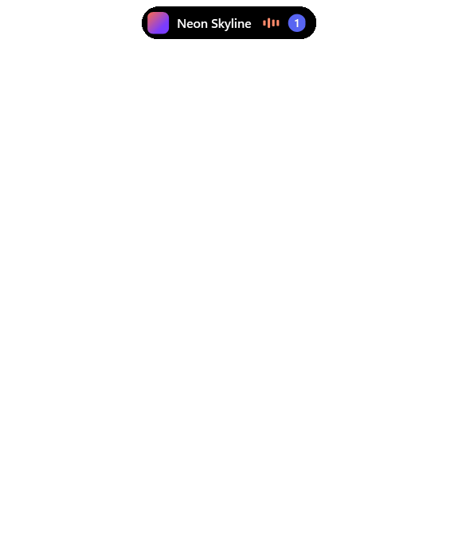

# IslandBar

[English](README.md) | **Français**

Une barre minimale façon Dynamic Island pour Windows 11. Elle reste invisible tant qu'il n'y a rien à montrer, puis apparaît en haut de l'écran pour afficher ta musique, tes notifications et les applications qui utilisent ton micro ou ta caméra.

**[⬇ Télécharger IslandBar-Setup.exe](https://github.com/LKDM7/IslandBar/releases/latest/download/IslandBar-Setup.exe)**



> Application conçue et codée avec **Claude Opus 5.5** d'Anthropic, dans Claude Code. Logo dessiné avec Codex.

## Ce qu'elle fait

- **Musique :** titre, pochette, égaliseur animé, lecture/pause, piste précédente et suivante. La barre de progression est cliquable, si le lecteur l'accepte, et prend la couleur de la pochette comme l'égaliseur. Au survol, les barres de lecture et de volume montrent la valeur visée avant le clic. Elle suit tout lecteur qui publie ses contrôles média à Windows, comme un navigateur.
- **Notifications :** toutes les applications par défaut (Discord, WhatsApp, Teams, mails...). Les réglages permettent de retirer celles qu'on ne veut pas voir. Auteur, message et image s'affichent 5 secondes. Le nombre de notifications non lues reste visible sur la barre. Plusieurs messages de la même personne tiennent sur une seule ligne, par exemple « Alice (3) ».
- **Notifications depuis tes scripts :** `IslandBar.exe --notify "Build terminé"` affiche ton propre message. Voir [Notifications depuis un script](#notifications-depuis-un-script).
- **Micro et caméra :** un point orange pour le micro et un point vert pour la caméra s'affichent quand une application les utilise, comme sur iPhone. Son nom apparaît au survol de la barre.
- **Accès au salon :** cliquer sur une notification Discord ouvre directement son salon ou sa conversation privée. Pour une autre application, le clic ouvre l'application.
- **Volume par application :** le réglage agit seulement sur l'application en lecture, pas sur le son général du PC.
- **Sortie audio :** passe du casque aux enceintes depuis le panneau. Contrairement au volume, ce choix vaut pour tout le PC.
- **Ne pas déranger :** pendant un jeu, une vidéo ou une présentation en plein écran, ou à la demande depuis les réglages, les notifications ne s'affichent plus. Elles sont gardées et reviennent dans le badge à la fin.
- **Choix de l'écran :** avec plusieurs écrans, les réglages permettent de choisir celui où s'affiche la barre.
- **Mises à jour :** IslandBar cherche les nouvelles versions dans les Releases et le signale par une notification. Un clic l'installe et la relance.
- **Discrétion :** sans rien à afficher, la barre est invisible et les clics passent au travers. Elle ne vole jamais le focus, sauf quand tu l'ouvres.
- **Langues :** l'interface est en français si Windows est en français, en anglais sinon.

## Raccourcis

`Ctrl + Alt + ²` ouvre ou ferme le panneau. La touche est celle à gauche de `1`, quelle que soit la disposition du clavier.

| Touche | Action |
|---|---|
| `Espace` | Lecture / pause |
| `←` `→` | Piste précédente / suivante |
| `↑` `↓` | Volume de l'application, par pas de 5 % |
| `S` | Dérouler la liste des sorties audio |
| `Entrée` | Ouvrir la notification la plus récente |
| `Suppr` | Effacer les notifications |
| `Échap` | Fermer le panneau |

Quand la barre est visible, un clic l'ouvre aussi. L'engrenage du panneau, ou un clic droit sur la barre, déroule les réglages : ne pas déranger, écran, applications à afficher et quitter. Une application y apparaît dès sa première notification. Tous ces choix restent enregistrés.

## Notifications depuis un script

Tant qu'IslandBar tourne, n'importe quel script peut lui envoyer un message :

```powershell
& "$env:LOCALAPPDATA\Programs\IslandBar\IslandBar.exe" --notify "Build terminé"
```

Le message s'affiche comme une notification, dans la limite de 300 caractères. Le code de sortie vaut 0 si le message est passé, 1 si IslandBar n'est pas lancée. Seul ton compte Windows peut écrire à la barre.

## Installation

Télécharge [`IslandBar-Setup.exe`](https://github.com/LKDM7/IslandBar/releases/latest/download/IslandBar-Setup.exe) depuis les [Releases](https://github.com/LKDM7/IslandBar/releases), puis lance-le. Il faut seulement Windows 11 (x64) : .NET est inclus et aucun droit administrateur n'est demandé.

L'installateur n'est pas signé. Si Windows SmartScreen s'affiche, clique sur **Informations complémentaires**, puis sur **Exécuter quand même**.

L'assistant propose de lancer IslandBar au démarrage de Windows et de masquer les bannières Windows de Discord. La désinstallation se fait depuis Paramètres › Applications et efface aussi le jeton Discord.

## Compiler depuis les sources

Il faut Windows 11 et le [SDK .NET 9](https://dotnet.microsoft.com/download/dotnet/9.0).

```powershell
git clone https://github.com/LKDM7/IslandBar.git
cd IslandBar
dotnet publish -c Release -r win-x64 --self-contained false -p:PublishSingleFile=true -o app
.\app\IslandBar.exe
```

Pour vérifier la logique interne (0 = OK) :

```powershell
.\app\IslandBar.exe --selftest; $LASTEXITCODE
```

### Créer l'installateur

Il faut [Inno Setup 6](https://jrsoftware.org/isinfo.php) en plus du SDK.

```powershell
dotnet publish -c Release -r win-x64 --self-contained true -o dist
& "$env:LOCALAPPDATA\Programs\Inno Setup 6\ISCC.exe" installer\IslandBar.iss
```

Le résultat est `installer\Output\IslandBar-Setup.exe`.

### Réglages Windows conseillés

L'installateur les propose. Sans lui, l'application ne les pose pas elle-même.

Lancer IslandBar au démarrage de Windows :

```powershell
$exe = (Resolve-Path .\app\IslandBar.exe).Path
Set-ItemProperty 'HKCU:\Software\Microsoft\Windows\CurrentVersion\Run' -Name IslandBar -Value "`"$exe`""
```

Retirer la bannière Windows de Discord, pour éviter une double notification :

```powershell
$discord = 'HKCU:\Software\Microsoft\Windows\CurrentVersion\Notifications\Settings\com.squirrel.Discord.Discord'
Set-ItemProperty $discord -Name ShowBanner -Value 0 -Type DWord
```

Si IslandBar est fermée, ces notifications n'apparaissent alors plus à l'écran. Elles restent dans le centre de notifications.

Pour les applications cochées dans les réglages, IslandBar coupe cette bannière tant qu'elle tourne. Elle la rétablit quand on la quitte depuis les réglages ou qu'on la désinstalle.

## Connexion à Discord

Aucune connexion n'est nécessaire pour ouvrir le bon salon depuis une notification récente. Un clic rejoue le clic Windows sur la notification : Discord ouvre lui-même le salon, sans compte à connecter ni réglage. Discord ferme sa notification au bout de quelques secondes (encore valable à 11 s, plus à 20 s lors du test). Passé ce délai, le clic ouvre simplement Discord.

Pour retrouver le salon d'une notification plus ancienne, IslandBar peut aussi utiliser l'API locale de Discord, car les notifications Windows ne contiennent pas l'identifiant du salon. Au premier lancement, Discord demande alors une autorisation à accepter une seule fois.

La connexion passe par l'application Discord définie par `ClientId` dans `DiscordRpc.cs`, en mode **Public Client**, avec la redirection `http://127.0.0.1`. Aucun secret n'est nécessaire.

Discord réserve cette API aux testeurs d'une application non approuvée. Elle reste facultative. Pour en profiter sur un autre compte, il faut soit être ajouté comme testeur, soit créer sa propre application et remplacer `ClientId`.

## Confidentialité

- Seuls deux services sont contactés : `discord.com`, pour obtenir et renouveler le jeton de connexion, et GitHub, pour chercher les mises à jour toutes les 6 heures et les télécharger. Aucune notification ni aucun nom d'application ne leur est envoyé.
- Une mise à jour n'est installée qu'après un clic, et seulement si son empreinte SHA-256 correspond à celle publiée sur GitHub.
- IslandBar n'ouvre jamais le micro ni la caméra : elle demande seulement à Windows quelles applications les utilisent. Elle ne reçoit ni son ni image, et n'enregistre rien de cet usage.
- Les notifications restent en mémoire et disparaissent à la fermeture de l'application. Seules celles des applications cochées s'affichent.
- La liste des applications vues et tes choix sont enregistrés dans `%APPDATA%\IslandBar\settings.json`.
- Le jeton est chiffré avec le compte Windows dans `%APPDATA%\IslandBar\discord.token`.
- La base de notifications de Windows est lue uniquement pour récupérer les photos de profil et l'étiquette qui permet de rejouer le clic. Seuls les fichiers locaux sont ouverts.

## Limites connues

- Chrome n'a qu'un volume pour tous ses onglets, donc le réglage les touche tous.
- La ligne de volume n'apparaît pas si l'application en lecture n'est pas reconnue, ce qui peut arriver avec Firefox ou certaines applications du Microsoft Store.
- La barre reste invisible par-dessus les jeux en plein écran exclusif. En fenêtré sans bordure, elle s'affiche.
- Il n'est pas possible de répondre à un message depuis la barre.
- La toute première notification d'une application s'affiche aussi dans Windows : IslandBar ne coupe sa bannière qu'à partir de là.
- Si IslandBar plante ou est arrêtée de force, les bannières Windows restent coupées jusqu'au prochain lancement suivi d'un « Quitter ».
- Hors Discord, le clic sur une notification ouvre l'application, pas le message précis.
- Rejouer le clic passe par un mécanisme interne de Discord, qu'une mise à jour de Discord pourrait changer. Le clic ouvrirait alors simplement Discord.
- Ouvrir soi-même une application du Microsoft Store n'efface pas toujours ses notifications de la barre : `Suppr` les retire.
- Changer la sortie audio passe par une interface Windows non documentée, qu'une mise à jour de Windows pourrait casser.
- Un logiciel qui écoute le micro en arrière-plan, comme un enregistreur de clips, garde le point allumé et donc la barre visible.
- Un micro branché pendant que la barre tourne peut mettre jusqu'à une minute à être suivi.
- Le point caméra n'a pas encore été essayé avec une vraie webcam.
- Testée uniquement sur un PC sous Windows 11 (build 26200).

## Licence

[MIT](LICENSE).
